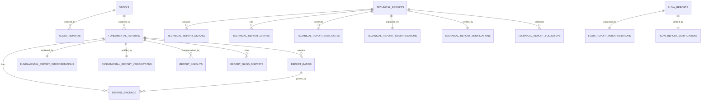

# veriθ Backend — 통합 PostgreSQL 스키마 (팀 공유 문서)

## CF-023 추가: 고정 의미 준비와 한정 검증 epoch

`c23001a7e0001`(parent `c22001a7e0001`)은 `supervisor_meaning_preparations`와 `supervisor_meaning_test_epochs`를 추가한다. 준비는 실행/결과 원장이 아니며 Flow 회계는 그대로다. 준비의 owner/key·request/draft/spec digest, immutable root/parent/depth(최대4 ancestor), attempt/state·plan hash·DB10분 TTL을 저장한다. 민감 draft/frame/초기 plan은 root에만 두고 child는 canonical 선택과 continuation만 갖는다. 같은 owner composite FK와 cycle/depth·상태/JSON/hash CHECK를 적용한다.

binding의 nullable preparation_id는 legacy 행을 보존한다. 첫 채택은 root→leaf/같은 depth UUID 순서로 모든 ancestor를 잠그고 같은 transaction에서 하나의 승리 binding 참조로 소비·redact한다. sibling도 shared ancestor로 단일 소비되며 양방향 owner/소비 관계는 commit-time 검증한다. 기존 binding의 immutable/redaction guard를 보존한다. 준비 GET/DELETE·만료 정리·늦은 결과와 보고서 삭제도 같은 lineage 잠금/원문 비부활 경계를 사용한다.

검증 epoch는 CF023 단위의 최대100,000,000 nanoUSD·attempt/count/generation 각2와 monotonic reservation/phase를 제한한다. count+generation 한 attempt는50,000,000 nanoUSD 예약을 공유한다. unknown/ACK 불명·usage 누락은 hold/blocked이며 TTL/삭제/재시작으로 환불/초기화하지 않는다. 공개 예산 API나 production 비용 활성화가 아니다. [공통 계약](../../docs/contracts/supervisor-core-v1.md)과 [이번 실행 상태](../../docs/work/CF-023-supervisor-meaning.md)를 따른다.

## CF-022 추가: Supervisor 확정 계획 binding

`c22001a7e0001`(parent `c18001a7e0001`)의 `supervisor_request_bindings`는 실행 원장이 아닌 계획→고정 Flow 입력 연결 한 표다. [공통 계약](../../docs/contracts/supervisor-core-v1.md)을 따른다. UUID PK/owner FK RESTRICT, owner+client_key_digest32 UNIQUE, 확정 digest와 plan/Flow JSON/hash, 유일 Flow key digest, finite DB confirmed_at/handoff_before(+120초)/redacted_at을 둔다. JSON object/크기/hash·identity·불변 trigger를 적용하며 populated downgrade는 거절한다.

binding ACK 확인 뒤 바깥 transaction을 끝내고 기존 AnalysisService/FlowUsageControl을 호출한다. 실행/claim/usage/result는 기존 Flow 원장만이 권위다. 삭제는 기존 session→analysis→root 잠금 순서 뒤 같은 transaction에서 연결 plan/Flow JSON을 null로 redact하며 hash/owner/key/usage를 보존한다. 표 누락 fallback은 없고 운영 적용은 migration 선행조건이다. 소유 PG 검사와 실제 운영 DB 적용 여부는 [작업 기록](../../docs/work/CF-022-supervisor-core.md)에서 구분한다.

## CF-003 추가: receipt-only Flow 접수

`flow_runs`는 `c3001a7e0001`에서 추가하는 접수 전용 테이블이다. 기존 결과 테이블을 재사용하거나
pending 결과/index를 만들지 않는다. [API/물리 계약](flow_run_admission.md)과
[이번 검증 기록](../../docs/work/CF-003-flow-run-admission.md)을 따른다.
owner FK RESTRICT, owner/operation/key-digest UNIQUE, 예약 attempt UNIQUE,
flow/version1/digest32/hex64/JSONB object/receipt_only/pending/not_stored/finite 시각 CHECK를 둔다.
키 원문은 저장하지 않으며 정규화 입력·fingerprint와 최초 추적/run/attempt ID를 보존한다.
실행권·예산·worker·snapshot·report 연결을 구현한 테이블이 아니다.

`docs/schema.md`

이 문서는 veriθ 백엔드의 **통합 ERD 기준 PostgreSQL 물리 스키마 정본**이다. 테이블·관계·타입·
제약·인덱스와 PostgreSQL/Neo4j 경계만 다룬다. 로컬 실행과 테스트는 [`../README.md`](../README.md),
스키마 변경 절차와 검증은 [`migrations.md`](migrations.md)를 따른다.

- 스키마 정의(정본): SQLAlchemy 모델 `backend/db/models/**` + Alembic 마이그레이션
- 최초 마이그레이션: `backend/db/migrations/versions/20260707_705a5833d4a3_add_integrated_postgresql_schema.py` (revision `705a5833d4a3`)
- DB 컬럼·테이블 변경은 이 문서를 먼저 갱신한다(코딩 가이드 §1.1).

---

## 1. PostgreSQL 확장 (extension)

최초 마이그레이션 `upgrade()` 가 테이블 생성 **전에** 아래를 만든다.

```sql
CREATE EXTENSION IF NOT EXISTS pgcrypto;   -- uuid PK 기본값 gen_random_uuid()
CREATE EXTENSION IF NOT EXISTS vector;     -- news.embedding 의 vector 타입
```

> **확장 관리 규칙:** `pgcrypto`/`vector` 는 **이 initial 마이그레이션에서만** 생성/삭제한다.
> **후속 마이그레이션에서는 extension 을 drop 하지 않는다** (공유 자원).

---

## 2. 타입 규칙

| 종류 | 규칙 |
|---|---|
| UUID PK | postgres `uuid`, 기본값 `gen_random_uuid()` |
| 종목코드/ticker/corp_code | **varchar (문자열)**. 숫자 타입 금지(앞자리 0 보존) |
| created_at / as_of | `timestamptz` (created_at 은 서버 기본값 `now()`) |
| base_date | `date` |
| JSON | `jsonb` |
| news.embedding | `vector` (pgvector, **차원 미지정** — §5 참고) |

---

## 3. 테이블 카탈로그 (23개, 도메인별)

### Common
| 테이블 | 요약 | PK |
|---|---|---|
| `stocks` | **공통 종목 마스터**(코드·이름·시장). `stock_name` 이 공식 이름 정본 | `stock_code` (varchar) |
| `stock_aliases` | 종목 별칭(변형/영문/약칭/구명/모호그룹). `stock_code` FK→stocks **ON DELETE CASCADE** | `id` (uuid) |
| `stock_corp_codes` | **DART 법인식별 정본**(`stock_code`→`corp_code`, 상장사만). `corp_code` UNIQUE, **stocks FK 없음(no-FK)** | `stock_code` (varchar) |
| `agent_reports` | 전 에이전트 리포트 통합 인덱스 | `id` (uuid) |

> **stocks 소유권/범위:** `stocks` 는 Backend 소유 공통 마스터로, 장기적으로 전체 국내 상장 종목을
> 담는다. **현재 seed 된 10종은 개발 bootstrap** 이며 전체 정본이 아니다. 전체 KIS 종목 마스터 동기화는
> [`stock_master_sync.md`](stock_master_sync.md) 참고(수동·네트워크, insert/update만·삭제 없음).
> Technical 10종 지원 정책(`BATTERY_TICKERS`)과는 **별개**다.
> `stock_aliases` 제약: `UNIQUE(normalized_alias, stock_code)` · `CHECK(normalized_alias<>'')` ·
> `index(stock_code)`. 공식 이름은 여기 중복 저장하지 않는다(정본=`stocks.stock_name`).
> Resolver 응답 의미·경계는 [`stock_resolver.md`](stock_resolver.md) 참고(여기 중복 안 함).
>
> **stock_corp_codes 소유권/경계:** DART OpenAPI `corpCode.xml` 기준 **법인식별 정본**(상장사 `stock_code`
> → 8자리 `corp_code`). `stocks`(KIS/KRX 마스터)와 **책임이 다른 별도 계층**이라 `stock_code → stocks`
> **물리 FK 를 걸지 않는다**(no-FK 논리 링크) — DART 상장 전체를 stocks 적재 상태와 무관하게 선반영하기
> 위함. `corp_name_from_dart` 는 DART 공시명 원문이며 **`stocks.stock_name` 정본을 대체하지 않는다**.
> 제약: `PK(stock_code)` · `UNIQUE(corp_code)`. 동기화는 [`dart_corp_code_sync.md`](dart_corp_code_sync.md)
> 참고(수동·네트워크, insert/update만·삭제 없음). 조회 endpoint/AI wiring 은 후속 브랜치.

### Fundamental (재무)
| 테이블 | 요약 |
|---|---|
| `fundamental_reports` | 재무 분석 리포트 root |
| `report_ratios` | 재무 비율(roe·부채비율 등) |
| `report_evidence` | 비율/주장의 DART 원천 근거 |
| `fundamental_report_interpretations` | LLM/규칙 해석 (1:1) |
| `fundamental_report_verifications` | 검증 결과 (1:1) |
| `report_insights` | 배당/주주/감사 등 맥락 인사이트 |
| `report_filing_snippets` | 공시 원문 스니펫 |

### Technical (기술적)
| 테이블 | 요약 |
|---|---|
| `technical_reports` | 기술적 분석 리포트 root. 목록 `GET /api/technical/reports` / 상세 `GET .../{id}`(read model + trust_summary) / 차트 `GET .../{id}/charts`(full payload) / trace `GET .../{id}/trace`(단계 재구성, duration null) — 계약 [`technical_frontend_api_contract.md`](technical_frontend_api_contract.md) |
| `technical_report_signals` | 지표 신호 |
| `technical_report_charts` | 차트 페이로드 |
| `technical_report_risk_notes` | 리스크 노트 |
| `technical_report_interpretations` | 해석 (1:1) |
| `technical_report_verifications` | 검증 (1:1) |
| `technical_report_followups` | 후속 질의. write: `POST .../{id}/followups`(answer=caller 제공, parent snapshot 저장) / read: `GET .../{id}/followups` |

> **Technical read model(조회 계약 ≠ 저장 형식).** `technical_reports.output_payload` 에 AI output 원본(raw)을
> 계속 보존하되, **API 응답(`POST`·`GET /api/technical/reports/{id}`)은 프론트 친화 read model**로 정리해
> 반환한다(`stock`(canonical)·`meta`·`summary`·`interpretation`·`drivers`·`signals`·`risks`·`charts`·
> `verification` 블록). `stock` 은 **canonical `stocks` 우선**. AI 구조화 해석(one_line_summary·directional_bias·
> timeframe_alignment·key_drivers 등)은 `technical_report_interpretations.sections`(JSONB)에 저장되며, read model
> 은 projection 이라 구버전 payload(섹션 없음)에서도 shape 가 안정적이다. backend 는 값을 재해석하지 않는다.
> 응답에는 **`trace_summary`**(생성 경로·데이터 품질·검증 요약·flag) 블록도 포함된다 — "어떻게 생성/검증됐는지"의
> 제품용 요약(raw trace 미노출). 저장값 projection 이라 신규 저장 없음. 계약 정본: [`technical_backend_handoff.md`](technical_backend_handoff.md).

### News (뉴스, PostgreSQL 부분만)
| 테이블 | 요약 |
|---|---|
| `news` | 기사 원본. `embedding vector`, `event_id`(Neo4j 논리 링크) |
| `news_reports` | 뉴스 질의 결과 리포트 (`report_id` PK) |

### Flow (수급)
| 테이블 | 요약 |
|---|---|
| `flow_reports` | 수급/자금흐름 리포트 root |
| `flow_report_interpretations` | 해석 (1:1) |
| `flow_report_verifications` | 검증 (1:1) |

CF-001은 물리 스키마를 변경하지 않는다. **이번 한시 호환 저장 방식**은 기존 `checks` JSONB의
`gate1/2/3`를 유지하면서 예약 키 `_flow_payload_snapshot`에 검증된 v1 원본을
보존한다. version·추가 필드·null·생략 보존과 구 자료 reader 규칙은
[flow_contract.md](flow_contract.md)를 따른다. 전용 snapshot 저장소는 후속이다.
신규 형식 표식은 checks와 agent_reports.summary의 `_flow_storage_format`에 함께
보존한다. 이는 물리 컬럼이나 payload version 추가가 아니다.

### Industry (산업/섹터)
| 테이블 | 요약 |
|---|---|
| `industry_reports` | 산업 에이전트 PostgreSQL 리포트 저장 테이블. `payload`=research-report.v1 전체 JSON 정본 |

> **명칭 확정:** 5번째 에이전트는 **industry(산업/섹터)**. 과거 `macro` 명칭은 폐기, 테이블은 `industry_reports`.
>
> **industry_reports 규약:**
> - `payload`(jsonb)는 산업 에이전트 **research-report.v1 전체 JSON 정본**이다.
> - `report_id`(text, UNIQUE)는 `payload.reportId` 와 매핑되는 **외부 노출 ID**. 내부 PK 는 `id`(uuid)다.
> - `status`(pending/processing/completed/failed)가 리포트 lifecycle 정본. `data_status`·`input_payload`·`output_payload` 는 통합 호환용(reserved).
> - `agent_reports.agent_report_id` 는 `industry_reports.id`(report_id 아님)를 가리키는 **app-level reference**(FK 없음).
> - **Neo4j 의 Company/Industry/Product/Policy/Person/Chunk 는 PostgreSQL 테이블로 만들지 않는다**(그래프는 app 레벨 별도 처리).
> - 인덱스: `report_id` UNIQUE, `created_at DESC`, `question_type`, `payload` **GIN**, `request_id`, `trace_id`.

---

## 4. 관계와 무결성 (PostgreSQL 한정)

Neo4j 그래프(EVENT/COMPANY/SECTOR/…)는 **PostgreSQL 테이블이 아니다**(§6). 아래는 PG FK만.



FK 전체 목록 (19개):

```
agent_reports.stock_code                        -> stocks.stock_code
fundamental_reports.stock_code                  -> stocks.stock_code
technical_reports.stock_code                    -> stocks.stock_code
flow_reports.stock_code                         -> stocks.stock_code
report_ratios.report_id                         -> fundamental_reports.id
report_evidence.report_id                       -> fundamental_reports.id
report_evidence.ratio_id (nullable)             -> report_ratios.id
report_insights.report_id                       -> fundamental_reports.id
report_filing_snippets.report_id                -> fundamental_reports.id
fundamental_report_interpretations.report_id(UQ)-> fundamental_reports.id
fundamental_report_verifications.report_id(UQ)  -> fundamental_reports.id
technical_report_signals.report_id              -> technical_reports.id
technical_report_charts.report_id               -> technical_reports.id
technical_report_risk_notes.report_id           -> technical_reports.id
technical_report_followups.report_id            -> technical_reports.id
technical_report_interpretations.report_id(UQ)  -> technical_reports.id
technical_report_verifications.report_id(UQ)    -> technical_reports.id
flow_report_interpretations.report_id(UQ)       -> flow_reports.id
flow_report_verifications.report_id(UQ)         -> flow_reports.id
```

**ON DELETE CASCADE** (자식 15개 FK): fundamental 7 + technical 6 + flow 2. report 삭제 시 자식이 함께 삭제된다. **`stocks` 참조 4개(agent_reports·fundamental_reports·technical_reports·flow_reports)는 마스터라 CASCADE 아님(NO ACTION).**

**FK 를 걸지 않는 것** (앱 레벨 논리 링크):
`agent_reports.agent_report_id`, `news.event_id`(Neo4j Event.canonical_id),
`news_reports.evidence`, 모든 `owner_user_id` / `owner_session_id`,
**`stock_corp_codes.stock_code`→stocks**(DART 계층 분리·상장 전체 선반영 목적, 의도적 no-FK).

UNIQUE (10): `technical_reports.request_id`, `news.url`, **`technical_report_signals(report_id, indicator)`**, **`stock_corp_codes.corp_code`**, 그리고 1:1 report_id 6개(fundamental·technical·flow interpretations/verifications).

**NOT NULL 정책(핵심):** 항상 존재하는 실행 메타데이터와 degraded에도 sentinel로 채워지는 컬럼만 NOT NULL. 예) `technical_reports`: `request_id`·`ticker`·`data_status`·`source`·`trace_id`·`as_of`·`input_payload`·`output_payload`·`final_regime`·`daily_regime`·`alignment_flag` = NOT NULL / `consensus`·`signal_score`·`confidence`·`weekly_trend`·`monthly_trend` = nullable. `news`: `title`·`url` NOT NULL. 통합 ERD 신규 컬럼(`timeframe`, `chart_*`)은 저장 정책 확정 전까지 nullable.

명시 인덱스 (`ix_` 18개 + signals UNIQUE 제약 1, DESC 는 표현식 인덱스):
```
agent_reports        (agent_type, created_at DESC) / (client_session_id, created_at DESC)
                     / (stock_code, created_at DESC) / (trace_id)
fundamental_reports  (request_id) / (stock_code, as_of DESC) / (trace_id)
technical_reports    (client_session_id, created_at DESC) / (stock_code, as_of DESC) / (ticker, as_of DESC) / (trace_id)
technical_report_charts     (report_id, period)
technical_report_signals    UNIQUE(report_id, indicator)
technical_report_risk_notes (report_id, severity)
technical_report_followups  (report_id, created_at)
news                 (event_id) / (published_at)
news_reports         (created_at DESC)
flow_reports         (stock_code, base_date DESC) / (ticker, base_date DESC) / (trace_id)
```

---

## 5. news.embedding 차원(dimension) 미정

- 임베딩 모델은 `arctic-embed-l-v2.0-ko`(news `SCHEMA_SPEC.md`)지만 **차원 숫자가 코드/문서에
  확정돼 있지 않아**, 컬럼은 **차원 없는 `vector`** 로 생성했다.
- 유사도 검색용 **ANN 인덱스(ivfflat/hnsw)** 는 차원 확정 후 **별도 마이그레이션**에서 추가한다.
  (dimensionless vector 에는 ANN 인덱스를 만들 수 없다.)

---

## 6. Neo4j 경계 — PostgreSQL 에 만들지 않는 것

아래는 뉴스 에이전트의 **Neo4j logical graph** 이며 **PostgreSQL 테이블로 만들지 않는다.**

```
EVENT, COMPANY, SECTOR, NEWSREF, KEYWORD, PERSON, COUNTRY
```

PostgreSQL 에는 `news.event_id`(nullable uuid)만 둬서 Neo4j `Event.canonical_id` 를 **논리적으로**
가리킨다. DB FK 는 없다. Event↔News 연결은 backend app 레벨에서 처리한다.

---

## 7. 마이그레이션 불변 규칙

- 모델 추가 시 `backend/db/models/registry.py`에 등록한다.
- 테이블·컬럼·제약 변경은 Alembic revision으로 반영한다.
- `pgcrypto`와 `vector`는 initial migration에서만 생성·삭제하고 후속 migration에서 drop하지 않는다.
- 이미 공유·적용된 migration은 수정하지 않고 새 revision에서 보강한다.
- 상세 생성·검증·트러블슈팅 절차는 [`migrations.md`](migrations.md)를 따른다.

---

## 8. 저장 계층 주의사항

- **`agent_reports.stock_code` / `fundamental_reports.stock_code` / `technical_reports.stock_code` / `flow_reports.stock_code`
  → `stocks.stock_code` FK**:
  리포트를 저장하기 전에 해당 종목이 `stocks` 에 있어야 한다.
  기본 지원 종목은 [`../README.md`](../README.md)의 seed 절차로 구성한다. 런타임 저장에서도
  결측에 대비해 `stocks`를 먼저 확보한 뒤 리포트/index를 저장한다.
- `stock_code` 는 **nullable** 이다(뉴스/산업/거시성 질의는 종목이 없을 수 있음).


## CF-002 v0.3 — 서버 인증과 Flow 소유권 확장

`auth_users`: 서버 발급 UUID PK, created_at timestamptz, nullable disabled_at.
`auth_identities`: UUID PK, user_id RESTRICT FK, 대소문자를 보존하는 nonempty issuer TEXT와
subject VARCHAR(255), created_at. UNIQUE(issuer, subject), user_id index. 최초 연결은 사용자와
신원을 같은 savepoint에서 생성하고 UNIQUE 경쟁 실패 시 둘 다 rollback 후 기존 신원을 읽는다.
`auth_sessions`: UUID PK, user_id RESTRICT FK, 유일한 SHA-256 token_digest BYTEA(32),
created_at/expires_at/revoked_at timestamptz. expires_at은 유한하며 created_at보다 미래,
revoked_at은 NULL 또는 created_at 이후. user_id/expires_at 및 expires_at index.
원문 난수 bearer는 DB에 저장하지 않는다. TTL 기본 3600초, 매 요청 DB 유효성 확인.

flow_reports.owner_user_id는 nullable RESTRICT FK이며 기존 행은 NULL 그대로 보존한다.
owner/created_at DESC/id DESC index를 추가한다. common agent_reports의 기존 owner/session
UUID는 논리 링크로 보존하고 global FK/UNIQUE/NOT NULL을 추가하지 않는다.
agent_type/owner/created_at DESC/id DESC 비유일 index를 추가한다.
Flow root owner가 정본이며 정확히 한 Flow index의 owner가 같아야 reader에 노출한다.
모든 목록/count/pagination/batch/detail/delete에서 SQL로 owner와 적격 projection을 검증한다.
삭제 잠금 순서는 유효 세션 공유 잠금 → 소유 root FOR UPDATE → index 정합성 → 삭제이다.
공개 저장·전체 삭제·다른 관점·Supervisor 직접 AI 경로는 닫는다.

b1e9d4a7c2f1 다음 확장 revision만 추가한다. auth 데이터 또는 nonNULL root owner가 있으면
파괴적 downgrade를 거부한다. 테스트 migration은 승인된 일회용 PostgreSQL의 구성·readonly
preflight 및 실제 SQLAlchemy 연결 재확인 후 동일 연결을 Alembic에 전달한다.
실제 외부 OIDC 검증은 내부 합성 세션/owner PostgreSQL 검증과 구별한다.


## CF-006 합성 입력 snapshot

`c6001a7e0001`은 기존 `flow_runs`에 `UNIQUE(id, owner_user_id)`만 더하고 `flow_input_snapshots`를 추가한다. 기존 receipt 값·상태·요청 키를 수정하지 않는다.

새 열은 id UUID PK, run_id/owner_user_id UUID, contract_version integer, mode TEXT, input_json TEXT, input_sha256 VARCHAR(64), sealed_at TIMESTAMPTZ이며 전부 NOT NULL이다. UNIQUE(run_id), (run_id,owner_user_id) composite FK/ON DELETE RESTRICT, version1/synthetic_only/finite 시각/UTF-8 128KiB/body version·mode/실제 SHA CHECK가 적용된다. no-op UPDATE·DELETE도 전용 trigger로 거부한다. domain의 canonical/schema/source 검증은 별도로 필요하다. 기존 receipt 자체의 DB 불변성이나 관리자 ALTER/DROP/TRUNCATE 차단을 추가한 것은 아니다. [내부 계약](flow_input_snapshot.md)을 따른다.


## CF-007 내부 fake 실행/결과

`flow_fake_executions`(c7001)은 input_snapshot_id UNIQUE FK/RESTRICT로 봉인 입력당 단일 실행권/결과를 저장한다. owner/run은 기존 input/run JOIN으로 판단하고 parent 열/제약을 추가하지 않는다. id/input/version/engine/claim/start/deadline은 불변, 상태는 running→succeeded/failed/timed_out 단1회이며 DELETE는 모든 상태에서 거부한다.

DB clock 기준10초 deadline·finite시각·상태별 결과/hash/error/finished NULL조합과 canonical 결과 object/UTF-8크기/hash/ID 관계를 검사한다. succeeded만 결과가 있다. token 원문은 저장하지 않고 digest32bytes만 보존한다. 기존 receipt/payload/report/index/stock은 바꾸지 않으며 관리자 DDL/장기 purge 정책은 별도다. [내부 계약](flow_fake_execution.md)을 따른다.

## CF-012 Flow 분석 원장

`flow_analysis_runs`는 receipt/synthetic/fake와 별도인 인증 분석 원장이다. owner/operation/key digest, attempt 및 채택 report ID가 유일하며 claim·시간·상태별 snapshot/null 관계를 DB 제약으로 검사한다. running→result_ready→stored→deleted와 failed/unknown terminal을 구분한다. result_ready의 canonical input/result 및 SHA를 먼저 commit하고 root/자식/index 게시와 stored 전이는 원자 처리한다. deleted는 요청·이름·입력·결과 본문을 비우고 최소 식별/hash만 보존한다. [공유 계약](../../docs/contracts/flow-analysis-v1.md).

## CF-015 · owned Fundamental analysis

`fundamental_analysis_runs` stores one immutable grant/request-context/result snapshot per owner/key. Unique attempt/report references and fenced state transitions prevent reuse after deletion. `fundamental_reports.owner_user_id` is nullable for legacy only. Owned readers require root + exactly one same-owner index + stored ledger; NULL legacy stays private.

## CF-018 편입 Flow 비용 원장

revision `c18001a7e0001`은 `analysis_usage_periods`(KST 기간·최초 한도 snapshot·횟수·held/추정 spend·blocked), `analysis_usage_reservations`(run/owner/attempt/grant·원 기간·고정 가격/상한·잔여 예약), `analysis_provider_calls`(유일한 provider/action/ordinal·UUID·attempted·nullable usage·정제 evidence hash)를 추가한다. 금액은 BIGINT 정수 nanoUSD이며 KIS 비용은 NULL이다. 원문·credential은 없다.

`flow_analysis_runs.budget_reservation_id`는 legacy에 NULL을 유지한다. 새 INSERT는 run ID와 같은 nonnull 참조가 필요하고, 양방향 composite FK 및 deferred constraint trigger가 commit 때 run↔reservation·기간 scope/owner/통화/날짜 관계를 확인한다. 식별·기간 한도·가격 snapshot은 불변이다. attempted True 역행과 확정 증거 교체, 회계 이력 삭제를 거부한다. 기존 report/receipt/synthetic schema·행은 변경하지 않는다. [사용 한도 계약](../../docs/contracts/flow-usage-v1.md)을 따른다. 실제 적용 여부는 [작업 기록](../../docs/work/CF-018-flow-usage-limits.md)과 구분한다.
# CF-035 내부 Technical owned snapshot

신규 revision `c35001a7e0001`은 `c23001a7e0001` 뒤에 연결한다. 운영 DB에는 적용하지 않았다.
`technical_reports.owner_user_id`는 nullable UUID FK(`auth_users`, RESTRICT)이며 owner/id index를 둔다.
기존 NULL owner와 기존 payload는 rewrite하거나 자동 귀속하지 않는다.
`agent_reports`의 owned Technical 행에는 `(agent_type, agent_report_id)` partial UNIQUE
(`agent_type='technical' AND owner_user_id IS NOT NULL`)를 추가한다. 기존 owned 중복이면 migration이 실패한다.

`technical_report_snapshots`는 report_id PK/FK(CASCADE)로 root와 1:1이다. owner_user_id FK와 저장 당시
owner_session_id UUID를 보존하며, 역사 session UUID에는 auth_sessions FK를 두지 않는다. 현재 인증은 별도로 검증한다.
format, request/trace UUID, L/B context TEXT, caller input TEXT, input/result schema, canonical input/result TEXT,
input/result/binding SHA-256와 DB 생성시각을 저장한다. UTF-8 크기 제한은 context 각4KiB, caller32KiB,
input16KiB, result2MiB다. DB는 필수값·JSON object·SHA 형식/실제 TEXT digest·format/schema를 검사하고,
UPDATE trigger로 snapshot 변경을 거절한다. root 삭제의 CASCADE는 유지한다.

이 표는 실행·예산 원장이 아니다. root/자식의 JSONB projection과 정확 TEXT를 구분한다. downgrade는 owned
root/snapshot/index가 있으면 거절하며 기존 데이터나 소유자를 자동 정리하지 않는다.

## CF044 · Supervisor 독립 회계 (운영 미조립)

`supervisor_meaning_accounts`: UUID PK, auth owner FK; operation/owner/canonical scope SHA UNIQUE. 정책·기간·model/spec/price/caps canonical TEXT/hash와 필수 총액/시도액/횟수, 누적예약·관측추정액·blocked. 예약 자동환급 없음.
`supervisor_meaning_reservations`: account+owner/preparation+owner 복합 FK, 저장 session FK, preparation/attempt UNIQUE. 고정 binding TEXT/SHA·예약액·TTL·held/observed/unknown/anomalous와 정제 receipt TEXT/hash.
새 revision c44001a7e0001은 c35001a7e0001 뒤 additive이며 기존 표를 변경하지 않는다. 두 새 표 ACCESS EXCLUSIVE 잠금 후 비어 있을 때만 downgrade한다. 운영 정책 발급·Gateway/송신 권위는 연결하지 않는다.

### CF045 준비별 의미 보완 grant

`c45001a7e0001`은 기존 CF044 계정·예약을 유지하고 `supervisor_meaning_grants`를 추가한다.
준비/attempt/nonce digest는 각각 UNIQUE이며 account·preparation·reservation의 동일 owner와
예약의 account/preparation/attempt를 composite FK로 결합한다. 원 Principal fingerprint와
준비 Binding, 정책/scope/counter hash, 요청 만료 시각을 저장한다. 준비 TTL은 기존 Binding에 남는다.
nonce 평문·질문·prompt·provider payload·키는 이 표에 저장하지 않는다.

count 소비와 CF044 예약·grant 연결, generation 소비, 정산과 terminal ACK는 각각 같은 SQL
transaction으로 commit한다. count/generation receipt는 최초 승자만 송신권을 반환하며 replay와
SELECT-only reconcile은 `newly_authorized=False`다. observed도 자동 환급하지 않고,
unknown/anomalous는 기존 예약을 유지하며 계정을 막는다. terminal ACK가 없는 held는 정산 미확인이다.
다운그레이드는 새 grant 표를 잠근 뒤 비어 있을 때만 허용한다. 이 migration은 기존 정책/행을
발급·갱신하거나 실제 운영 DB에 자동 적용하지 않는다.

## CF048 · Technical 전용 접수와 보수 hold

`c48001a7e0001`은 `c45001a7e0001` 뒤에 두 표만 추가한다. 기존 Flow/Supervisor 회계는 변경하지 않는다.

- `technical_usage_periods`: operation/KST 일자 UNIQUE인 서비스 단일 기간. UTC 시작/끝과 명시 policy/가격/cap TEXT·SHA, 사용자/서비스 횟수·금액 상한, 누적 횟수/예약·blocked를 보존한다. 같은 날 정책 교체나 카운터 감소는 금지다.
- `technical_analysis_runs`: owner/operation/key digest UNIQUE. 원 admission session ID, 고정 서버 ID 6개, intent·Stock·spec snapshot/hash, 원 period/policy, 시작/기한, claim digest/소비 시각, admitted/claimed/unknown·고정 이유·redaction 시각과 예약/hold를 저장한다. 원 session에는 신규 FK를 걸지 않으며 원 owner와 period-policy에는 RESTRICT FK를 둔다.

INSERT/UPDATE guard는 identity·정책/기간·실행당 예약과 정책의 deadline 상한을 결합한다. claim은 한 번만 소비하고 intent는 NULL로만 삭제할 수 있다. DELETE/TRUNCATE와 hold 환급은 금지다. deferred trigger는 commit 최종 상태에서 run COUNT/예약 합과 period 누적값·사용자 한도를 대조한다. downgrade는 새 두 표의 ACCESS EXCLUSIVE 잠금 아래 비어 있을 때만 허용한다.

이 표는 내부 SQL 접수/로컬 claim이며 provider 송신권·정산이나 운영 활성화가 아니다. [서비스 계약](../../docs/contracts/technical-boundary-v1.md#cf048-technical-전용-접수와-로컬-claim)과 [직접 검증](../../docs/work/CF-048-technical-admission.md)을 따른다.

### CF050 · 같은 run의 완료 snapshot

`c50001a7e0001`은 c480 뒤 기존 `technical_analysis_runs`에 nullable completion_format·input/result TEXT/SHA·binding SHA·accepted_at·error_code 8컬럼을 추가한다. 새 표/예약·기존 revision 변경은 없고, 이전 3상태·NULL 완료 필드는 그대로 유효하다.

claimed→result_ready→stored와 필요한 failed/unknown 전이만 추가한다. 첫 accept의 실제 SQL fence는 원 claim/세션·owner·Stock·기간·원 deadline 및 B/S binding을 대조한다. accepted hash/시각은 이후 불변이며 ready만 pending TEXT를 보유한다. stored/failed/unknown은 원 intent와 pending input/result TEXT를 NULL로 소비하되 ID/key/hash·claim·전체 hold는 유지한다. 미채택 실패에는 완료 metadata가 없다.

같은 commit의 root/snapshot/전체 Technical index 정확1개·owner/hash·실제 stage session을 deferred guard로 결합한다. 연결된 stored 정본의 root/snapshot/index 변경·삭제·TRUNCATE를 거절하며 미연결 기존 보고서는 이 새 결합에 포함하지 않는다. 전체 child projection의 의미 검증은 기존 CF035 writer/read를 재사용한다. downgrade는 원 period/run을 잠그고 새 상태/완료 값이 전부 없는 경우에만 이전 CHECK/guard를 복원한다. 이는 전용 테스트 PG에 적용한 검증이며 운영 DB 적용은 아니다. [완료 계약](../../docs/contracts/technical-boundary-v1.md#cf050-같은-technical-run의-결과-수신과-저장-복구)을 따른다.

### CF053: 동일 Technical run의 start/evidence (c53001a7e0001)

새 table/registry/Flow ledger 없이 `technical_analysis_runs`에 nullable execution 열12개를 추가한다.
`execution_configuration_json/sha256`은 비밀 없는 명시 policy/counter/caps/origin 구성,
`execution_grant_digest`는 일회 opaque grant의 SHA256,
`execution_control_json/sha256`은 원 IDs·intent/B/Stock/spec/policy/config hash·예약·원 기한 binding이다.
`execution_started_at`, `execution_executor_id`, `execution_start_json/sha256`은 단일 fresh start를,
`execution_evidence_json/sha256`, `execution_observed_at`은 최대16KiB 최종 관측을 보존한다.
raw grant·key·HTTP header·raw SDK 오류·prompt/response는 새 관측 열에 저장하지 않는다.

기존 spec은 새 execution 열이 전부 비어 있어야 한다. 새 spec/config는 INSERT 뒤 불변이고,
claim/grant·start·evidence는 한 방향으로만 고정된다. 기존 period/owner/key/FK·삭제/TRUNCATE 보존
경계와 전액 hold를 재사용한다. evidence는 실제 정산/환급이 아니며 expiry/revocation 뒤 record-only
수신도 실행권을 만들지 않는다. 같은 hash만 replay하고 다른 late evidence는 conflict다.

snapshot FORMAT/B/L은 유지한다. `technical_report_snapshots`의 정확 old synthetic/new controlled
schema 조합, SQL run spec에서 분기한 binding hash와 completion/stored guard를 함께 적용한다.
controlled snapshot은 대응 accepted/stored provider run 없이 생성할 수 없다. c530 자체의 부분 DDL
실패는 같은 transaction에서 rollback하며 provider record가 있으면 downgrade를 DROP 전에 거절한다.
기존 c350/c480/c500 migration bytes는 수정하지 않는다.
